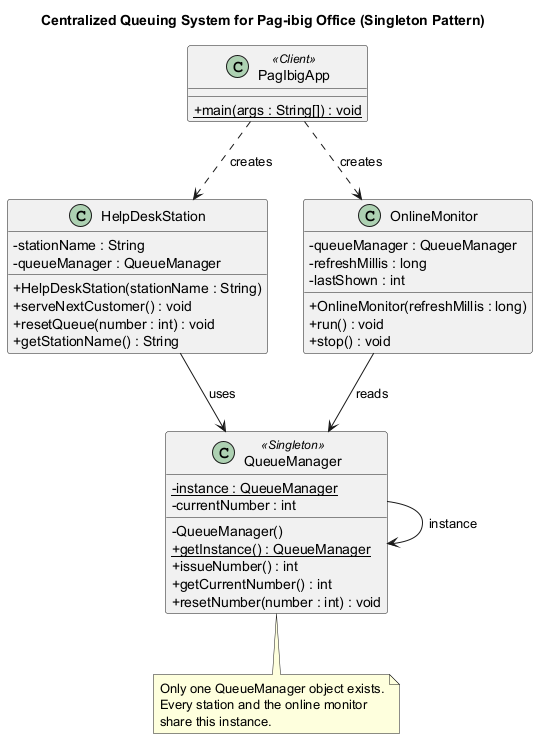

# Centralized Queuing System for Pag-ibig Office (Singleton Pattern)

## Problem Statement

The Pag-ibig office implements a centralized queuing system for three help desk stations. Individuals visiting the office obtain a queue number from this centralized system. Additionally, there's an online monitoring system that displays the current queued number in real-time for individuals monitoring the queue remotely.

Each help desk station has an option to reset the queuing number based on an inputted number, allowing flexibility in managing the queue during specific situations, such as reorganization or technical issues. This queuing system ensures a single centralized queue number for all help desk stations, while the reset option offers control and adjustment in exceptional circumstances.

This approach aims to maintain an organized queuing process for individuals visiting the office and provides the flexibility to handle queue adjustments as needed.

### Class Definitions

- **QueueManager (Singleton):** Holds the one and only queue number. It has a private constructor, a private static `instance`, and a public static `getInstance()` method. It exposes `issueNumber()`, `getCurrentNumber()`, and `resetNumber(number)`.
- **HelpDeskStation:** One of the three help desk stations. Each station uses `QueueManager.getInstance()`, so all stations share the same queue. It can serve the next visitor (`serveNextCustomer()`) or reset the queue (`resetQueue(number)`).
- **OnlineMonitor:** The remote display. It runs on its own thread, reads the shared queue through `getCurrentNumber()`, and prints the number in real time.
- **PagIbigApp:** The client class that creates the three stations and the monitor to simulate the office.

## UML Class Diagram

PlantUML source: [docs/pag-ibig-singleton.puml](docs/pag-ibig-singleton.puml)



## Java Code

All source files are in [src/](src/):

| File | Role |
| --- | --- |
| `QueueManager.java` | Singleton that owns the centralized queue number |
| `HelpDeskStation.java` | Help desk station that issues and resets numbers |
| `OnlineMonitor.java` | Real-time online monitoring display |
| `PagIbigApp.java` | Client / demo program |

## How the Singleton Pattern Is Applied

1. **Private constructor** — `QueueManager` cannot be created with `new` from outside the class.
2. **Private static instance** — the class keeps the only object it will ever create.
3. **Public static accessor** — `getInstance()` returns that object, creating it only on the first call.
4. **Thread safety** — `getInstance()` is `synchronized`, and every operation on the queue number is `synchronized`, because the online monitor reads the number while the stations update it.

Because of this, the three stations and the online monitor always see the same queue number, which is exactly the requirement of the centralized queuing system.

## How to Run

### In GitHub Codespaces (nothing to install)

1. On this repository page, click **Code → Codespaces → Create codespace on main**.
2. Wait for the container to finish (Java 21 and the Java extension pack are installed automatically from `.devcontainer/devcontainer.json`).
3. Open the terminal and run:

```
cd src
javac *.java
java PagIbigApp
```

In VS Code you can also press **F5** and choose **Run PagIbigApp**.

### Locally (JDK 21 or newer)

```
cd src
javac *.java
java PagIbigApp
```

## Sample Output

```
=== Pag-ibig Office: centralized queuing system ===

--- Visitors are served at the three stations ---
  [Online Monitoring] Current queue number: 0
[Help Desk 1] Now serving queue number 1.
  [Online Monitoring] Current queue number: 1
[Help Desk 2] Now serving queue number 2.
  [Online Monitoring] Current queue number: 2
[Help Desk 3] Now serving queue number 3.
  [Online Monitoring] Current queue number: 3
[Help Desk 1] Now serving queue number 4.
  [Online Monitoring] Current queue number: 4
[Help Desk 2] Now serving queue number 5.
  [Online Monitoring] Current queue number: 5

--- Reorganization: Help Desk 2 resets the queue to 500 ---
[Help Desk 2] Queue reset. Next number to serve is 500.
  [Online Monitoring] Current queue number: 500
[Help Desk 3] Now serving queue number 501.
  [Online Monitoring] Current queue number: 501
[Help Desk 1] Now serving queue number 502.
  [Online Monitoring] Current queue number: 502

--- Proof that there is only one queue manager ---
Same object for the app and the online monitor? true
Current queue number seen by everyone: 502

Office closed. Final queue number: 502
```
